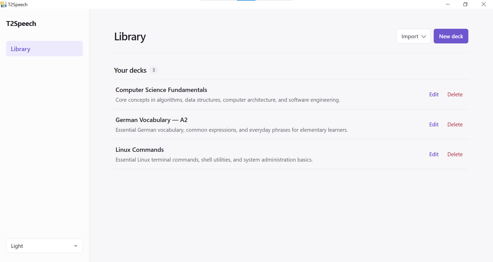
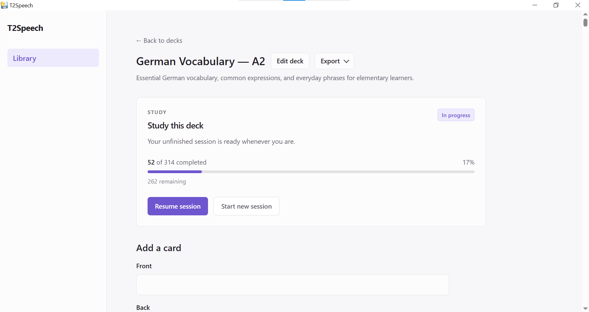
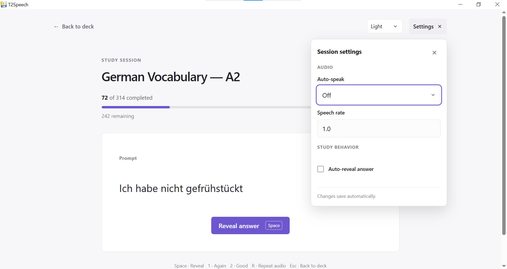
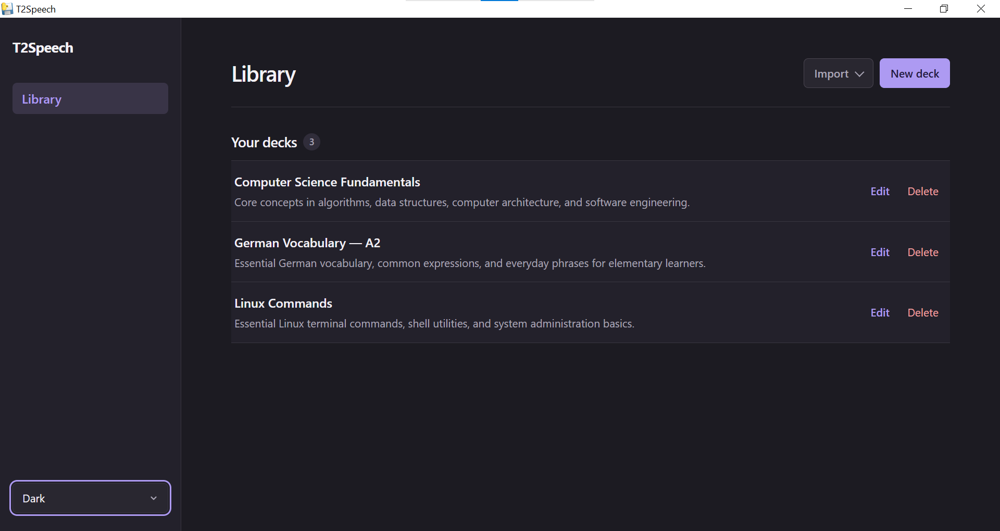
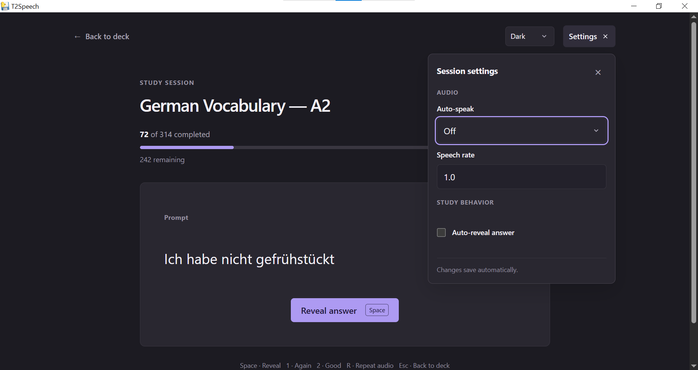

<div align="center">

# T2Speech

**A local-first, open-source flashcard app with text-to-speech and audio-assisted study.**

[](https://github.com/atakankeskin99/T2Speech/releases/tag/v0.2.0)
[](https://github.com/atakankeskin99/T2Speech/releases/tag/v0.2.0)


[](LICENSE)

**[Screenshots](#screenshots) · [Features](#features) · [Download](#download--installation) · [Development](#development) · [License](#license)**

</div>

---

T2Speech is a small, local-first project built around flashcards, text-to-speech, and a straightforward study workflow. It keeps data on the user's machine and avoids unnecessary external services.

**Current release:** `v0.2.0` is a Windows portable preview. It works on the development computer, but the downloaded package has a known startup issue and has not yet been validated on a separate Windows computer. See [Known Issue](#known-issue--windows-startup).

## Screenshots

### Light Theme

**Library**



**Deck View**



**Study Mode**



<details>
<summary><strong>Dark Theme</strong> — Library and Study Mode screenshots</summary>

**Library**



**Study Mode**



</details>

## Features

- **Deck and card management:** Create, edit, and organize decks and cards.
- **Study Mode:** Reveal answers, evaluate cards with **Again** or **Good**, track progress, and resume unfinished sessions.
- **Session controls:** Shuffle cards, study them in reverse, and use keyboard shortcuts.
- **Text-to-speech:** Listen to cards using voices available on your system, with playback and automatic speech options.
- **CSV and XLSX:** Import cards from spreadsheets with a preview step, and export deck content.
- **Local storage:** Decks, cards, and study sessions are stored in SQLite on your computer.
- **Themes:** Light and dark appearances.

## Download & Installation

### Windows — v0.2.0 Portable Preview

**[Download v0.2.0 for Windows](https://github.com/atakankeskin99/T2Speech/releases/tag/v0.2.0)** · [Release notes](https://github.com/atakankeskin99/T2Speech/releases/tag/v0.2.0)

1. Download `T2Speech-v0.2.0-windows-x64.zip` from the release page.
2. Extract the entire ZIP file.
3. Open the extracted `T2Speech` folder.
4. Run `T2Speech.exe`.

Keep `T2Speech.exe` and its `_internal` folder together. The portable application does **not** require Python or Git.

**Requirement:** Microsoft Edge WebView2 Runtime.

### Known Issue — Windows Startup

Some extracted v0.2.0 downloads may fail to start with a `Python.Runtime.Loader.Initialize` error. In local testing, Windows' downloaded-file security marking affected a bundled runtime DLL. The permanent fix is still pending.

**Possible workaround:** Right-click the **downloaded ZIP file** (not the extracted folder), select **Properties**, and use **Unblock** on the **General** tab if available. Apply the change, extract the ZIP again, and retry. This ZIP-level method has not been independently validated across Windows systems.

Recursively unblocking files in the extracted folder resolved the problem during local testing. The [v0.2.0 release notes](https://github.com/atakankeskin99/T2Speech/releases/tag/v0.2.0) document the PowerShell workaround. Only unblock files from sources you trust.

**Status:** Preview; reliable startup on other Windows systems is not yet confirmed.

## How to Use

1. Create a deck in the Library.
2. Add cards manually or import them from CSV/XLSX.
3. Start a study session, reveal each answer, and choose **Again** or **Good**.
4. Resume an unfinished session when you return.

<a id="development"></a>
<details>
<summary><strong>Development</strong> — history, roadmap, architecture, setup, and testing</summary>

### Development Journey

I was looking for a flashcard app that suited the way I wanted to study. I tried a few, but none felt quite right, so I decided to build my own. T2Speech started as a personal project, and I eventually made it open-source for anyone who might find it useful.

**v0.1.0** was the first Windows portable preview, providing a desktop window without requiring users to start the development server manually.

**Development after v0.1.0** focused on refining the study experience and making its behavior more reliable:

- **Study workspace:** A distraction-free layout with a centered flashcard, inline Prompt/Answer reveal, separate Again/Good actions, a compact progress indicator, and keyboard shortcuts.
- **Session lifecycle:** Persistent sessions with card snapshots, Resume, Shuffle, Reverse Cards, explicit confirmation before replacing an active session, and a dedicated completion screen with Study Again.
- **Session settings:** A compact Settings popover with immediately applied options and automatic SQLite persistence for auto-speak, speech rate, auto-reveal, and reveal delay. Failed saves can be retried.
- **Reliability:** Transactional Again/Good evaluation, stale or duplicate rating-request protection, correct handling of abandoned sessions, and stricter speech-rate validation.
- **Deck navigation:** A single Export dropdown for CSV and XLSX instead of separate export buttons. Library-level importing remains available through its existing Import dropdown.
- **Regression coverage:** A reusable pytest/Playwright Study Mode suite in addition to the original unittest-based tests.

These changes are described in the [v0.2.0 release notes](https://github.com/atakankeskin99/T2Speech/releases/tag/v0.2.0). The portable build's launch issue remains unresolved.

### Roadmap

| Milestone | Status |
| --- | --- |
| Deck and card management | Completed |
| Study Mode, persistent sessions, and session lifecycle | Completed |
| Study workspace refinement and automatic session-settings persistence | Completed |
| Text-to-speech and audio-assisted study | Completed |
| CSV/XLSX import and export | Completed |
| Study Mode regression suite (pytest + Chromium) | Completed — 48 tests passed on Windows |
| Windows portable ZIP (`v0.2.0`) | Released — preview; startup issue pending |
| Reliable startup and validation on another Windows computer | Pending |
| Docker self-hosting | Planned |
| Linux compatibility testing | Planned |
| Additional desktop packaging | Planned |

The roadmap describes current priorities, not fixed delivery dates.

### Technology Stack

| Component | Technology |
| --- | --- |
| Backend | Python 3.13, FastAPI |
| ASGI server | Uvicorn |
| Database and session persistence | SQLite |
| Templates | Jinja2 |
| Frontend | HTML, CSS, vanilla JavaScript |
| Text-to-speech | Browser Web Speech API (available local voices) |
| CSV processing | Python standard library |
| XLSX processing | openpyxl |
| Automated testing | unittest, pytest, FastAPI TestClient, Playwright (Chromium) |
| Desktop integration | pywebview |

T2Speech favors a small, maintainable stack and local data storage over external infrastructure. Study Mode settings and progress use the existing SQLite session tables rather than a separate persistence service.

### Project Structure

Selected files and directories relevant to development (other templates and tests omitted):

```text
T2Speech/
├── app/
│   ├── main.py
│   ├── desktop.py
│   ├── database.py
│   ├── models.py
│   ├── services/
│   │   ├── csv_import.py
│   │   ├── csv_export.py
│   │   ├── xlsx_import.py
│   │   ├── xlsx_export.py
│   │   └── import_staging.py
│   ├── static/
│   │   ├── css/
│   │   │   └── app.css
│   │   └── js/
│   │       ├── app.js
│   │       └── study.js
│   └── templates/
│       ├── deck.html
│       ├── study.html
│       ├── study_setup.html
│       └── study_complete.html
├── docs/
│   └── screenshots/
│       └── v0.2.0/
├── tests/
│   ├── baseline_theme_tokens.json
│   └── study_mode/
│       ├── conftest.py
│       ├── test_study_assets.py
│       ├── test_study_browser.py
│       └── test_study_routes.py
├── desktop_smoke.py
├── requirements.txt
├── requirements-desktop.txt
├── requirements-test.txt
├── LICENSE
└── README.md
```

For source-based development, `data/decks.db` contains the local SQLite database; the `data/` directory is excluded from version control. The Windows portable build uses `%LOCALAPPDATA%\T2Speech\data` for its database and logs.

### Development Setup

These instructions are for contributors and anyone who wants to run the local web version from source. The Windows portable release does **not** require Python or Git.

**Prerequisites:** Python 3.13 (current development target), Git, pip, virtual environment support, and a modern web browser.

**Windows — tested during development**

```cmd
git clone https://github.com/atakankeskin99/T2Speech.git
cd T2Speech
python -m venv .venv
.venv\Scripts\activate.bat
python -m pip install -r requirements.txt
if not exist data mkdir data
python -m uvicorn app.main:app --reload
```

For PowerShell, activate the environment using `.\.venv\Scripts\Activate.ps1` instead.

**Linux — not yet validated**

```bash
git clone https://github.com/atakankeskin99/T2Speech.git
cd T2Speech
python3 -m venv .venv
source .venv/bin/activate
python -m pip install -r requirements.txt
mkdir -p data
python -m uvicorn app.main:app --reload
```

Open `http://127.0.0.1:8000` after starting the server. The `--reload` option is for development only. Linux instructions are preliminary and may require adjustment.

### Testing

Two complementary test suites are maintained. Run these commands from the repository root with the project virtual environment activated.

**Existing unittest suite:**

```bash
python -m unittest discover -s tests -v
```

This suite covers CSV/XLSX processing, Unicode and file validation, duplicate detection, import staging, SQLite transaction rollback, and study-session isolation during imports. At the **v0.1.0** release milestone, 43 automated unittest tests passed; that figure is a historical release result, not a combined current total.

**Study Mode regression suite (pytest + Playwright):**

Install the test-only dependencies and Chromium once:

```bash
python -m pip install -r requirements-test.txt
python -m playwright install chromium
```

Then run the complete Study Mode suite:

```bash
python -m pytest tests/study_mode -v
```

To run subsets independently:

```bash
python -m pytest tests/study_mode -m "not browser" -q
python -m pytest tests/study_mode -m browser -q
```

The Study Mode suite covers session creation, resumption and replacement; Again/Good queue behavior and duplicate-request protection; card snapshots; settings persistence and validation; keyboard controls; TTS fallback behavior; Light/Dark theme tokens; and Chromium layout checks across desktop and mobile widths. Tests use isolated temporary SQLite data, not the user's normal `data/decks.db`.

**Latest local result (Windows, Python 3.13): 48 passed, 1 non-blocking Starlette/httpx deprecation warning.** The test result applies to the Study Mode suite, not the complete set of legacy and new tests together. Browser tests do not replace manual checks with real system speech voices. CSV/XLSX import and export were also manually verified during this development cycle.

### Platform Compatibility

| Platform | Status |
| --- | --- |
| Windows portable ZIP | Available — preview (`v0.2.0`), known startup issue |
| Windows local web application | Tested during development |
| Linux local web application | Not yet validated |
| Windows installer | Not available |
| Linux desktop package | Planned |
| Docker deployment | Planned |

### Technical Limitations

- The Windows portable distribution has a known startup issue and has not yet been validated on a separate Windows computer.
- Linux compatibility and Docker-based deployment have not yet been verified or released.
- Speech playback depends on the voices available on the user's system.
- CSV/XLSX exports contain card content, not full application backups or study-session history.
- Native Anki `.apkg` import and cloud synchronization are not supported.
- `desktop_smoke.py` is an experimental pywebview integration test, not a standalone application launcher. Optional desktop dependencies are listed in `requirements-desktop.txt`.

### Contributing

Bug reports, suggestions, and contributions are welcome through [GitHub Issues](https://github.com/atakankeskin99/T2Speech/issues) and Pull Requests. Keep changes focused, describe their purpose, and run both the existing unittest suite and the relevant pytest tests before submitting a PR.

</details>

## License

T2Speech is free and open-source software distributed under the [MIT License](LICENSE).
